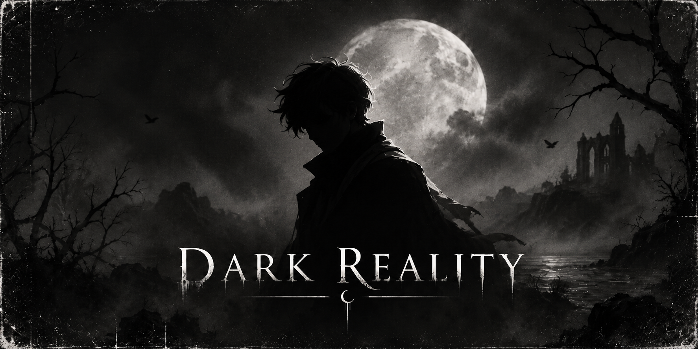

<p align="center">
  
</p>

<p align="center">
  <a href="https://github.com/Madushan996/Project-DarkReality/releases"></a>
  
  
  
  
  <a href="https://github.com/Madushan996/Project-DarkReality/releases"></a>
  <a href="LICENSE"></a>
</p>

<h3 align="center">🦇 The aim of this project is to create the strongest possible chess engine from scratch,<br>through human expertise and AI collaboration. 🦇</h3>

<p align="center">
  
</p>

## 🌕 About

DarkReality is an original UCI chess engine written in Rust. It does not use code copied from other engines, and it does not use networks from other engines. Instead, it is built on established theoretical concepts developed over decades by the computer chess community, implemented independently here.

The main objective of this project is to push the limits of chess engine development through human–AI collaboration. During its development, I used the knowledge and experience gained from my previous engines, CeylonDemon and NARC Next. All of the major design ideas came from me, and I used Claude Code and Codex for faster implementation and for testing those ideas. Finally, all decisions about which ideas to keep and which to reject were taken by me.

## ⚗️ Tools

For this project, I vibe-coded a tool called **EngineArena**, powered by [fastchess](https://github.com/Disservin/fastchess), which lets me measure strength gains between versions accurately and seamlessly. It can also measure actual strength autonomously against 20–30 anchor engines, so I had a good awareness of the engine's CCRL-equivalent strength during the whole development. I am also hoping to open-source EngineArena in the near future.

## 💀 Strength

| Time control | CCRL-equivalent rating (0.4.8) |
|:---|:---:|
| 🩸 Blitz | **3568 ± 26** |
| 🕯️ Long (40/15) | **≈ 3500** |

These numbers were measured relative to stable CCRL anchor engines using EngineArena.

<p align="center">
  
</p>

## 🕸️ Built on established ideas

- **Search:** principal variation search with alpha-beta pruning, a lockless transposition table, aspiration windows, singular extensions, null-move pruning, futility and late-move pruning, static exchange evaluation, ProbCut and late-move reductions, guided by history-based move ordering and correction histories.
- **Evaluation:** an efficiently updatable neural network (NNUE) with 64 king buckets → 256×2 → 8 output buckets, SCReLU activation and AVX2 integer inference.
- **Training:** the network architecture, trainer ([trainer/](trainer/)) and weights are all DarkReality's own, trained on public CC0 labelled positions.

## ⚰️ Download

Windows binaries are on the [Releases](https://github.com/Madushan996/Project-DarkReality/releases) page. The network is embedded in the executable. The `avx2` build needs a CPU with AVX2 (Intel Haswell / AMD Excavator or newer).

DarkReality has no GUI. Summon it inside a UCI chess GUI such as [Cute Chess](https://cutechess.com/), [Arena](http://www.playwitharena.de/), [Banksia](https://banksiagui.com/) or [En Croissant](https://encroissant.org/).

## 🔮 Build

Requires stable Rust 1.85 or newer.

```bash
git clone https://github.com/Madushan996/Project-DarkReality.git
cd Project-DarkReality
cargo build --release
```

The binary is written to `target/release/darkreality`. `nets/current.nnue` is embedded at compile time; set `DR_NET=path/to/net.nnue` to embed another network.

The default build targets the local CPU (`-C target-cpu=native`). For a portable AVX2 binary:

```bash
RUSTFLAGS="-C target-cpu=x86-64-v3" cargo build --release
```

Run the tests with `cargo test`.

## 🗝️ Usage

```bash
darkreality                        # UCI mode
darkreality bench [depth]          # fixed-depth search benchmark
darkreality perft <depth> [fen]    # move-generation test
```

UCI options: `Hash`, `Threads` (1), `Move Overhead` and `UCI_Chess960`.

<p align="center">
  
</p>

## 📜 License

DarkReality is free software under the [GNU General Public License v3.0 or later](LICENSE).

Copyright © 2026 Madushan Dissanayake.

## 🎃 Acknowledgements

- The computer chess community, and the [Chess Programming Wiki](https://www.chessprogramming.org/) for documenting decades of its ideas.
- [Gigafish](https://huggingface.co/datasets/lukesalamone/gigafish-3.8b-d10) and the [Lichess evaluation database](https://database.lichess.org/#evals) for CC0 training labels.
- [fastchess](https://github.com/Disservin/fastchess), which powers EngineArena.

<p align="center"><sub>🕯️ Forged in the dark, one move at a time. 🕯️</sub></p>
